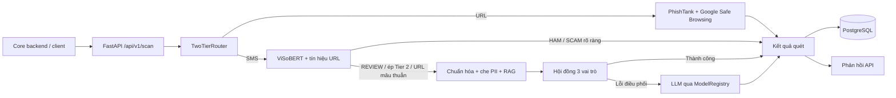

# ScamShield AI Pipeline

Microservice FastAPI phát hiện tin nhắn lừa đảo tiếng Việt. Dịch vụ nhận SMS hoặc URL, kết hợp ViSoBERT, đối chiếu URL và phân tích Tier 2 có RAG. Kết quả quét được lưu trong PostgreSQL.

## Kiến trúc



- **URL đứng riêng:** chỉ đối chiếu PhishTank và Google Safe Browsing. URL khớp nguồn đe dọa trả `SCAM-RISK`; không khớp trả `UNKNOWN`. URL đứng riêng không chạy ViSoBERT hoặc RAG.
- **SMS, Tier 1:** ViSoBERT phân loại `HAM`, `REVIEW` hoặc `SCAM`; URL trong SMS được tra thêm ở hai nguồn trên. Kết quả rõ ràng được trả trực tiếp.
- **SMS, Tier 2:** chạy khi ViSoBERT trả `REVIEW`, URL đe dọa mâu thuẫn với `HAM`, hoặc yêu cầu đặt `force_tier2=true`. Tin nhắn được chuẩn hóa và che PII trước khi truy xuất RAG và gửi đến hội đồng. Nếu hội đồng lỗi ở cấp điều phối, router thử LLM qua `ModelRegistry`.
- **Lưu trữ:** `POST /api/v1/scan` lưu kết quả và các đoạn RAG đã dùng vào PostgreSQL. `PHONE` và `BANK_ACCOUNT` do Core backend xử lý, không phải đầu vào của dịch vụ này.

### RAG

Khi `RAG_ENABLED=true`, API dùng một instance BGE-M3 chung cho nạp tài liệu và truy xuất. Tác vụ nền đọc các URL trong `config/rag_sources.yaml` ngay sau khi khởi động, rồi lặp lại mỗi 24 giờ khi tiến trình API còn chạy. Nó cũng đọc các ca JSON trong `data/rag/approved_cases/` nếu thư mục này tồn tại. Nội dung được chuẩn hóa, che PII, chia đoạn, tạo embedding và lưu bằng pgvector.

Với mỗi SMS chuyển lên Tier 2, RAG tìm tối đa 5 đoạn gần nghĩa trên tài liệu đang hoạt động, còn hiệu lực và mang trạng thái `VERIFIED`. Chỉ các đoạn vượt ngưỡng trong `config/rag_threshold.json` mới được đưa vào prompt cùng `chunk_id`. Cosine similarity đo độ liên quan của đoạn, không phải xác suất lừa đảo. Nếu RAG không khả dụng hoặc không tìm được đoạn phù hợp, Tier 2 vẫn tiếp tục mà không có chứng cứ RAG.


## Service
Yêu cầu: Docker Compose, hoặc Python 3.10–3.12 và PostgreSQL có pgvector. Các tệp model lớn được quản lý bằng Git LFS.

```bash
git lfs pull
cp .env.example .env
docker compose up -d --build
```

Điền khóa dịch vụ cần sử dụng trong `.env` và đổi `POSTGRES_PASSWORD` khi chạy ngoài máy phát triển. Compose khởi động PostgreSQL cùng API tại `http://localhost:8000`; tài liệu tương tác ở `http://localhost:8000/docs`. Lần khởi động đầu có thể cần tải BGE-M3.

Để chạy API trực tiếp, đặt `DATABASE_URL` trỏ tới PostgreSQL có pgvector, kích hoạt môi trường Python của bạn, rồi chạy:

```bash
python -m pip install -r requirements.txt
python -m uvicorn api.app:app --host 0.0.0.0 --port 8000
```


## API

| Endpoint | Chức năng |
| --- | --- |
| `GET /health` | Trạng thái Tier 1, Tier 2 và database. |
| `POST /api/v1/scan` | Quét SMS hoặc URL và lưu kết quả. |
| `POST /api/v1/scan/raw` | Trả kết quả nội bộ để gỡ lỗi; không lưu lần quét. |
| `POST /api/v1/visobert/predict` | Gọi trực tiếp bộ phân loại ViSoBERT. |

Ví dụ yêu cầu quét:

```json
{
  "content": "Tài khoản của bạn bị khóa. Truy cập https://example.com để xác minh.",
  "check_type": "SMS",
  "force_tier2": false
}
```

`check_type` chỉ nhận `SMS` hoặc `URL`. Có thể truyền `core_check_id` là ID dương của `check_requests` trong Core để các lần thử lại cập nhật cùng tác vụ. Phản hồi chuẩn hóa gồm verdict, gợi ý xử lý và telemetry; xem schema thực tế tại `/docs`.

## Mã nguồn chính

| Đường dẫn | Vai trò |
| --- | --- |
| `api/` | FastAPI, endpoint và schema. |
| `pipeline/two_tier_router.py` | Định tuyến URL, Tier 1 và Tier 2. |
| `pipeline/visobert_classifier.py`, `pipeline/url_signals.py` | Phân loại SMS và tra nguồn URL. |
| `pipeline/forensic_council.py`, `pipeline/model_registry.py` | Hội đồng phân tích và LLM dự phòng. |
| `pipeline/rag.py`, `pipeline/rag_ingestion.py` | Embedding, truy xuất và nạp nguồn RAG. |
| `pipeline/persistence.py`, `db/` | Lưu kết quả, schema và migration PostgreSQL. |
| `config/` | Nguồn RAG, ngưỡng truy xuất và cấu hình model. |
| `scripts/`, `tests/` | Huấn luyện, hiệu chỉnh, benchmark và kiểm thử. |

Chạy kiểm thử bằng `pytest`. Demo dòng lệnh: `python demo_scamshield_mvp.py`.
